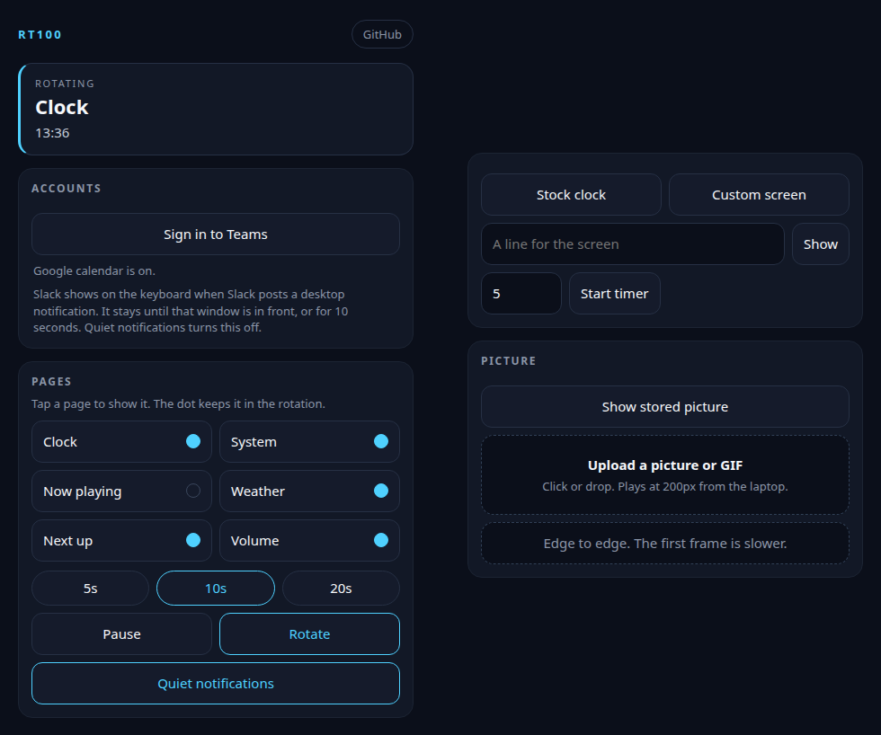
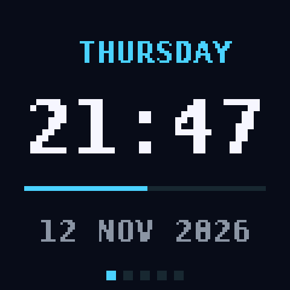
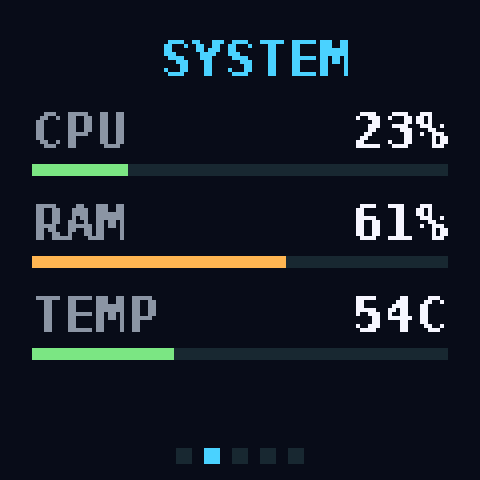
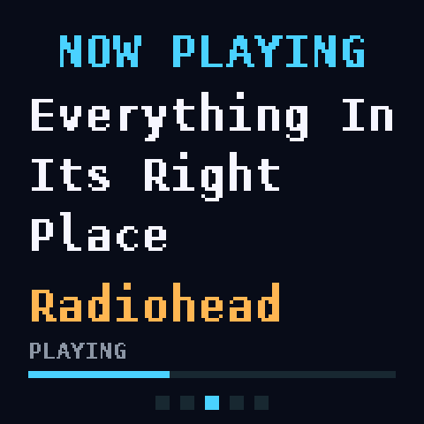
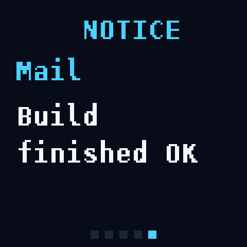

# RT100 screen

Custom pages for the detachable screen on an Epomaker RT100 keyboard: a clock, CPU and memory, now playing, weather, the next calendar event, volume, notifications, and pictures or GIFs you drop on it.

The program runs on Linux and talks to the screen through the keyboard cable. It is free to use, change, and share under the MIT license.

## What it looks like

The control app is a small window on the computer. It chooses the pages, starts a timer, and takes a picture or GIF.



The keyboard screen is 240 by 240. These are pages it draws:







## Read this before flashing

**You flash at your own risk.** This writes firmware into the screen on your keyboard. A failed write, or a cable that comes out halfway, can leave that screen blank forever, and it can leave the keyboard unable to talk to a computer. There is no recovery mode, no second copy, and no debug port. Nobody who wrote this software can repair it for you, and the MIT license includes no warranty. If you are not willing to lose this keyboard, do not flash it.

Flash only the image in this project, only over the keyboard cable, and only while the cable stays plugged in until the script says the firmware was verified. The wireless dongle is not supported.

The flasher also refuses to write if the keyboard does not report device id 946, which is the RT100 this was built for.

## What you need

This was put together on Ubuntu, on a normal desktop login. The install commands below are Ubuntu's. A different distribution can run the same program if it has the same pieces, but that has not been tried.

- The RT100, with its screen attached, plugged in by the cable
- Ubuntu, logged in at the desktop. Python 3.10 or newer is installed by the script if it is missing

## Install

From this directory, while logged in to the desktop:

```sh
./install.sh
```

It asks for your password once. That does not flash the screen. Until you flash, the screen keeps its original clock.

What that command installs and starts:

- Ubuntu packages: Python, `python3-venv`, pip, GTK, the Ayatana status icon, `x11-utils`, and `curl`
- The keyboard permission, `/etc/udev/rules.d/99-epomaker-rt100.rules`, so the logged-in user can open the RT100 (vendor `3151`). Unplug the keyboard and plug it back in after the script finishes
- A Python environment in `.venv` inside this folder, with Pillow (pictures) and psutil (the CPU page)
- The background service `~/.config/systemd/user/rt100screen.service`. It is started immediately, and again each time you log in. It runs `.venv/bin/python screen/rt100screen.py run` from this folder, and systemd restarts it if it crashes. It does not start at machine boot before anyone has logged in
- The top-bar icon service, `rt100-indicator.service`
- The application menu entry **RT100** (`~/.local/share/applications/rt100-screen.desktop`). Opening it shows the control page

The service files in `screen/` contain `@ROOT@` on purpose. `install.sh` fills in the path of this folder when it copies them into your home directory. Copying those files by hand leaves `@ROOT@` in place and the service will not start.

If you move this folder, run `./install.sh` again so the services point at the new path.

PipeWire (`wpctl`), the notification bus, and MPRIS are already part of an Ubuntu desktop, so the script does not install them. Chrome is not installed either. The RT100 app uses Chrome or Chromium when one of them is present, and otherwise opens the page in your usual browser.

Settings you change later are stored per user, not in this folder:

- `~/.config/rt100screen.json` for the city, which pages rotate, and whether notifications are quiet
- `~/.config/rt100screen-teams.json` for the Teams sign-in. That file is a secret. Do not commit it or send it to anyone

## Flash

```sh
./flash.sh
```

The script asks you to type YES. That means you accept the risk above. It stops the screen program, writes `device/custom/out/firmwareOledFile.bin`, checks the keyboard's reply, and starts the program again. Leave the cable in until it finishes.

If it stops early and says nothing was written, the screen is unchanged. If it fails after the write has started, leave the cable in. If the keyboard then stops responding, unplug it and plug it back in. Do not start another flash unless the message said nothing was written.

## Everyday use

Open **RT100** from the app menu, or go to http://127.0.0.1:8765 in a browser. The page is only on this computer.

From that page you can:

- Pick which pages rotate, and how long each one stays
- Pause on one page, or go back to the original clock
- Show the picture stored in the firmware
- Click or drop a picture or a GIF. A GIF keeps its frames, up to 24, and loops
- Start a timer
- Set the weather city
- Sign in for the next Teams meeting, or add the Google account Ubuntu already uses
- Slack messages appear when Slack posts a desktop notification

The top-bar icon, when installed, opens the same controls.

Weather uses [Open-Meteo](https://open-meteo.com/). Set the city from a terminal if you prefer:

```sh
.venv/bin/python screen/rt100screen.py location London
```

To put the original clock back:

```sh
.venv/bin/python screen/rt100screen.py stock
```

## What works on this Ubuntu setup

These are the desktop services the pages talk to. On this machine they are the Ubuntu defaults.

- **Now playing** reads MPRIS on the session bus (`busctl`). Players that publish MPRIS show up. A player that does not will leave that page blank.
- **Volume** reads PipeWire through `wpctl`, which Ubuntu installs. A system with only the older PulseAudio tools and no `wpctl` will not show a level.
- **Notifications** watch the desktop notification bus with `dbus-monitor`. The screen shows the application name, the summary, and a short line of the message for 10 seconds, or until that application's window is the one in front. Slack is included when Slack is allowed to post desktop notifications. There is no separate Slack login. Quiet mode on the control page turns this off.
- **CPU, memory, temperature, battery** come from `psutil`. Temperature prefers a `coretemp` package sensor, which is what this laptop reports. A desktop with no battery simply omits that line.
- **Weather** asks Open-Meteo. Nothing is fetched until a city is saved.
- **Next meeting** is the sooner of the Teams calendar and the Google calendars. Teams uses Microsoft Graph in the browser, as the "Microsoft Graph Command Line Tools" app. GNOME's own Microsoft account does not provide that calendar, so Teams needs its own sign-in. Google uses the Google account in Ubuntu Settings, under Online Accounts, and Evolution reads it. Holiday calendars are left out. The control page has a button for each.
- **The control window** prefers Chrome or Chromium in a small app window. Without either, it opens http://127.0.0.1:8765 in whatever browser `xdg-open` uses. The page itself is the same.

Agent notices (Cursor and Claude writing `~/.local/state/rt100screen/agent.json`) are a separate local hook. `install.sh` does not install those hooks. The window title on that page is read with `xwininfo` on display `:1`, which matches this Ubuntu session. On another seat, or on Wayland without that X display, the page still works and shows the project folder instead of the window title.

## Limitations

- **Ubuntu desktop is the known setup.** The packages, the user service, PipeWire, MPRIS, and the status icon are what Ubuntu provides. Other distributions are welcome to try it; they are untested.
- **Cable only.** Day-to-day use and flashing both go through the wired keyboard. The 2.4 GHz dongle is untested, and the flasher will not use it.
- **One program at a time.** A second copy of the screen program exits. Two programs sending at once corrupt the session.
- **The keyboard's own keys and firmware are left alone.** This project only drives the detachable screen.
- **Uploads are played from the laptop.** A dropped GIF is cut to at most 24 frames, reduced to 16 colours, and the laptop sends each loop again. The screen does not keep that upload in its own memory, and unplugging the cable stops the animation on the last frame. The "stored picture" button plays a clip that was built into the firmware, which is separate from whatever you last dropped.
- **The first pose of an upload is the slow one.** Later frames send only the pixels that changed.
- **Pictures from the command line** are scaled to 200 pixels unless you pass `--full`.
- **After a reboot of the keyboard** (cable out and back in), the keyboard paints its original interface again. The service redraws the custom page a couple of seconds later.
- **Building a new firmware image** needs the ARM toolchain and the base image under `device/patch/`. Everyday install and flash use the image already in `device/custom/out/`. You do not need `research/` for either.

## If the screen looks wrong

Stop there. From a terminal:

```sh
.venv/bin/python screen/rt100screen.py stock
```

That returns the original clock. If the keyboard stops answering the tools, unplug it and plug it back in.

## License

The screen program (`screen/`) and the custom firmware sources (`device/custom/`) are under the MIT license. See [LICENSE](LICENSE). Anyone can use them.

Two things in the tree are not part of that grant:

- `research/driver/` is Epomaker's own installer, kept for reference
- The file you flash is Epomaker's screen firmware with this project's changes added. It is included so you can install it on an RT100 you own

You do not need the `research/` directory to install or flash.
